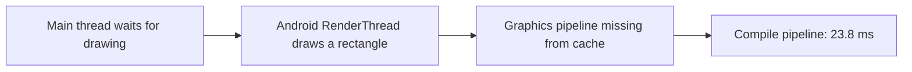

# Perfetto report 2: findings and proposed fixes

**Audience:** a Kotlin/Compose developer who does not work with performance traces every day.

This report explains the findings in [the original report](perfetto_analysis_report.md) and proposes implementation steps. It uses the same recording, taken on **14 October 2026, 10:48:33–10:50:13 CEST**, on the Samsung S26. The recorded flow was login, map swipes, status entry, an attempted friend addition, and changing proximity alerts in Settings. This is a second explanation of that recording, rather than a new measurement.

The first priorities are **reducing repeated map creation** and **checking whether camera updates cause unnecessary rendering**. A separate, isolated graphics compilation delay deserves a smaller investigation. The recording contains no app crash or ANR report and does not establish a memory leak.

## Reading the numbers

- A **frame** is one screen update. At 120 Hz, the investigated frames had about **8.3 ms** to finish; at 60 Hz, the interval is about **16.7 ms**. Missing the presentation deadline can produce a visible stutter, also called **jank**.
- The **main thread** handles input and Compose UI work. A **RenderThread** performs Android UI drawing. Mapbox also has its own native rendering thread. Waiting in one can delay another.
- **CPU time** measures actual execution. **Wall time** includes execution and waiting. A 70 ms frame does not mean the CPU worked for 70 ms.
- **Measured** below means the original trace contains the event or counter. **Likely** describes an interpretation. **Proposed** describes a change that still needs verification.

The original analysis found **107 missed app deadlines among 3,234 submitted app-surface frames, about 3.3%**. Twelve of those frames exceeded 16.7 ms. These counts describe submitted app frames; they are not a measurement of the map's perceived FPS. The original report explains how duplicate surface entries and system display delays were handled.

| Priority | Finding | Measured cost | Confidence | Proposed action |
|---|---|---|---|---|
| 1 | Opening and recreating the map stalls the UI | About 71 ms initially and 47 ms on a later creation | Stalls and new renderers are confirmed; the exact Mapbox waiting call is partly inferred | Keep one map instance through short navigation, with explicit visibility and lifecycle handling |
| 2 | Map rendering continues at a high rate while entering text | About 118–120 fps; 5.45 CPU seconds during a 12-second gap between map touch events | Workload confirmed; redundant work and battery impact remain unmeasured | Inspect camera update cadence, remove confirmed duplicates, then compare a 60 fps limit |
| 3 | A drag interaction triggers graphics compilation | About 43 ms for the submitted frame; 23.8 ms inside compilation | Compilation cause confirmed; exact control is unknown | Compare first and repeated drags before changing drawing code |

## 1. Smooth returns to the map by avoiding repeated construction

### What happened

**Measured:** around 29.6 seconds into the recording, opening the map took about **71 ms** for one frame. Its first Compose composition took **19.4 ms**. The main thread also waited while Mapbox created Vulkan graphics resources and Android prepared drawing buffers. Around 95.3 seconds, another map creation produced a **47 ms** submitted frame, with a **28.3 ms main-thread wait** overlapping Vulkan initialization.

Vulkan is the graphics API used by the map in this recording. Creating its device and display buffers costs more than drawing another frame with an existing renderer. **Likely:** repeating this setup contributes to the pause when returning to the map. The trace cannot prove that Vulkan explains every millisecond of the wait.

The recording contains three separate Mapbox renderer lifetimes. Earlier renderers stop before later ones start. That supports repeated construction; it does not show old renderer threads accumulating.

### Where to change the app

[MainActivity.kt](app/src/main/java/com/kumpello/whereiseveryone/main/MainActivity.kt) currently creates `MapScreen` inside the `MainRoute.Map` destination. [MapContent.kt](feature/main/src/main/java/com/kumpello/whereiseveryone/feature/main/ui/map/MapContent.kt) creates the map component there.

The locally inspected Mapbox Compose **11.31.1** source creates a `MapView` inside `remember`, and its disposal calls `onStop()` and `onDestroy()`. Its renderer's stop/start methods pause and resume rendering. This makes the composition lifetime a useful place to investigate.

### Proposed solution

Keep the expensive map component in a stable, Activity-owned part of `MainScreen`, while the existing navigation controls Friends and Settings above it. Keep screen-specific controls and ViewModels in their appropriate scopes, including the map's existing navigation owner when moving the component. Keep SDK initialization options stable across route changes, since changing those options can recreate the view. This is a presentation change; it does not require a new repository or application-wide map singleton.

The retained map needs these states:

| App state | Map behavior |
|---|---|
| Map visible | Render and collect visual updates |
| Friends or Settings fully covers it | Retain the instance, pause rendering and map-only collectors |
| Activity in the background | Pause according to lifecycle |
| Activity disposed or user logs out | Release the map and its listeners |

Connect visibility to the navigation state, including transition completion. An Activity can remain started while Settings covers the map, so Activity lifecycle alone is insufficient. Keep the existing icon-based transitions and rounded screen clipping.

Update the visibility handling in `MapContent` at the same time: its current `LifecycleStartEffect` relies on lifecycle or composition disposal to mark the map inactive. A map that stays composed needs an explicit route-visibility signal or an appropriate lifecycle owner. Pause road matching, camera animation and visual source updates when covered. Location sharing should continue to follow its existing service policy, including shutdown when the task is swiped away.

`remember` inside a destination retains objects while that composition exists; it does not preserve them after removal. Saving camera values with `rememberSaveable` preserves data, not the live native renderer. [Compose state documentation](https://developer.android.com/develop/ui/compose/state)

Keep `MapView` ownership in the UI. ViewModels should hold state and business logic; they should avoid references to Activity-related objects. [ViewModel guidance](https://developer.android.com/topic/libraries/architecture/viewmodel#best-practices)

**Tradeoff:** retaining the map may increase memory use on Friends and Settings. It can reduce repeat initialization, but it cannot eliminate the first map creation. Check that pausing and resuming the retained view actually avoids device recreation in this SDK and device combination.

### How to verify

Manually repeat Map → Friends → Back and Map → Settings → Back five to ten times on the S26 with a release build. Count map creation/disposal events and record return-frame times, covered-map CPU activity and memory after each cycle.

Success means fewer repeated renderer constructions, shorter return stalls, little map rendering while covered, and stable memory across cycles. Test back/predictive-back transitions, rotation, backgrounding, logout and swipe-away cleanup. If retention costs too much memory, keep recreation and focus on moving optional map setup out of the first visible frame.

## 2. Reduce map work when continuous updates add little visual value

### What happened

**Measured:** Mapbox rendered roughly **118–120 frames per second** through much of the map portion. Its animation slices consumed **18.36 CPU seconds**. A typical frame was inexpensive enough for 120 Hz: median **3.8 ms**, with 95% taking no more than **5.2 ms**.

During a **12-second interval without map touch events**, it still rendered **1,428 frames**, consuming **5.45 CPU seconds** in those animation slices. Keyboard activity continued, consistent with text entry during the user's flow. The trace also contains many camera animation end events.

**Likely:** follow-puck or heading updates keep the map changing. **Unknown:** whether those updates were redundant. The recording does not expose the actual position, heading and camera targets, and it does not measure battery drain. Continuous animation can be appropriate when the user moves or turns the phone.

### Proposed solutions

Start with short, development-only measurements in [Map.kt](feature/main/src/main/java/com/kumpello/whereiseveryone/feature/main/ui/map/Map.kt) and [UserLocationMarker.kt](feature/main/src/main/java/com/kumpello/whereiseveryone/feature/main/ui/map/UserLocationMarker.kt). Count app-requested follow transitions, SDK indicator callbacks and GeoJSON source writes—the marker data sent to Mapbox. Record a stationary phone, normal walking/panning, and status typing separately. Aggregate counts rather than logging every frame.

Use those measurements to choose the change:

- If the app repeatedly requests an identical camera target, skip the duplicate request and preserve the active animation. Distinguish app requests from camera updates generated inside the SDK.
- If position and bearing callbacks generate several source writes for one displayed frame, batch their latest values into one update. The marker already checks exact changes and uses `conflate()`; that drops queued intermediate values when collection is slow, but does not impose a fixed update rate.
- If tiny heading fluctuations dominate, evaluate a threshold based on visible rotation. Handle angle wrap correctly: 359° to 1° is a 2° change. Position filtering must respect the current zoom and retain Double coordinate precision.
- When a screen fully covers the map, pause visual work using the visibility handling from solution 1.

Then compare the existing behavior against a **60 fps map limit**. The following is an experiment to place inside the existing `MapboxMap` content:

```kotlin
MapEffect(Unit) { mapView ->
    mapView.setMaximumFps(60)
}
```

Mapbox exposes this limit on `MapView`; the locally inspected 11.31.1 source confirms the API. It limits map rendering, rather than the whole Compose interface. Use lifecycle/visibility handling to stop a covered map; zero is not a supported FPS limit. [MapView API](https://docs.mapbox.com/android/maps/api/latest/mapbox-maps-android/com.mapbox.maps/-map-view/)

**Tradeoff:** a lower limit can make panning and marker motion less smooth on a 120 Hz screen. It may reduce CPU work, but this trace cannot predict the battery saving. Keep the limit only if the measured benefit justifies the visual change.

### How to verify

Compare the same stationary, walking, panning and typing scenarios before and after each individual change. Check renderer CPU time, source-write counts, frame deadlines and perceived responsiveness. Check normal/car mode, marker heading and pitch, and the previously fixed zoom-out clipping behavior.

For layer-level attribution, Mapbox's development-only performance statistics can report rendering costs and texture/vertex allocations. These probes add overhead, so use them for comparison runs rather than leaving detailed sampling on in production. [Performance statistics](https://docs.mapbox.com/android/maps/guides/debugging-and-profiling/performance-stats/)

## 3. Investigate the single graphics compilation hitch before changing Settings

### What happened

**Measured:** at about 92.2 seconds, a submitted frame took **42.8 ms**. The main thread initially finished its work in **2.4 ms**, but Android's RenderThread spent **39.4 ms** drawing. Inside that drawing, **23.8 ms** was graphics-pipeline compilation after a cache miss. The following main frame waited about **31.7 ms** for rendering to finish.



A graphics pipeline tells the GPU how to draw a particular combination of shapes, paint and rendering settings. This event shows that Android had to compile one during interaction. It occurred during dragging, plausibly in the Settings portion of the flow, but the exact control or drawing modifier is unknown. Only one such compilation event was recorded.

### Proposed solution

Manually compare the first proximity-slider drag after opening the app with several subsequent drags. Check whether `CompileAfterCacheMiss` appears only once or keeps recurring.

If it keeps recurring, identify the affected draw operation before editing [SettingsScreen.kt](feature/main/src/main/java/com/kumpello/whereiseveryone/feature/main/ui/settings/SettingsScreen.kt). Inspect changing clips, shadows, brushes and graphics layers on that control. Reuse stable drawing configuration or simplify the particular effect if a controlled comparison shows that it triggers repeated compilation.

If it occurs only on first use, treat it as a graphics setup cost. Evaluating earlier drawing of the real affected state may move that cost ahead of the gesture, but it is a hypothesis to verify; hidden/offscreen rendering may use a different pipeline.

The proximity preference already has a **250 ms save debounce** in [SettingsViewModel.kt](feature/main/src/main/java/com/kumpello/whereiseveryone/feature/main/ui/settings/SettingsViewModel.kt). The measured delay does not establish a preference-writing or slider-calculation bottleneck. Preserve immediate slider feedback.

Android's UI renderer and Mapbox's native renderer are separate. The existing `mapboxVulkan` Gradle flag can support a controlled comparison of map startup backends, but changing it is not an established fix for this Android UI pipeline event.

**Success criteria:** subsequent drags avoid repeated compilation stalls while keeping slider feedback and the current appearance.

## Memory, errors and lower-priority cleanup

Memory deserves measurement alongside map retention. Recorded process memory rose from about **158 MiB** to a peak of **346 MiB**, then fell several times. The GPU-memory counter peaked near **300 MiB**. These counters can overlap, so adding them does not give a reliable total. System low-memory callbacks occurred during early map loading, but no low-memory process kill was recorded and those callbacks do not explain the preceding 71 ms frame.

If repeated navigation produces retained growth after the app settles, capture Java/native allocation evidence or a heap dump to identify what remains reachable. This short recording alone does not identify a leaked object. The original trace also does not establish whole-device CPU saturation, thermal throttling or a significant stop-the-world garbage-collection pause.

The captured login HTTP 403 and add-friend HTTP 404 may be expected rejected inputs. Confirm the attempted inputs and user-visible error handling before classifying them as backend defects.

Map initialization also logs missing marker sources, a missing shadow image and following before the location component is enabled. Inspect initialization order and use a supported valid shadow configuration for the hidden native puck. Class-lookup warnings need comparison with the matching release APK and R8 mapping before changing keep rules. The recording does not prove that these warnings cause the ongoing marker behavior or the measured stalls.

## Suggested implementation order

1. Establish a current release-build baseline using the same manual flow, with matching APK/R8 mapping and short creation/update counters.
2. Prototype retained map ownership together with covered-map pausing. Measure both return-frame improvements and memory cost.
3. Remove confirmed redundant camera/source updates. Compare a 60 fps limit as a separate experiment so its effect is identifiable.
4. Check first versus repeated proximity-slider drags, then change drawing code only if the hitch is reproducible.
5. Clean up confirmed initialization warnings and repeat the flow after each change.

Use the same device, renderer backend, map area/zoom, charging state and build type for comparisons. The recording predates the location-service swipe-away fix; validate that behavior separately on the current build. After code changes, run the project's tests, lint and debug build, and ask the user to perform the short phone checks.

All performance measurements here come from [the original report and its reproducible SQL](perfetto_analysis_report.md). Source inspection makes the proposals concrete; it does not prove that the current source exactly matches the recorded APK. No new profiler recording or performance fix was made when writing this report.
